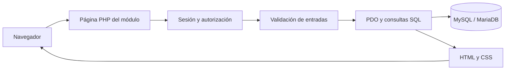

# Arquitectura y operaciones — Versión 1.0, versión final 1

En esta guía explicamos cómo organizamos el código de `SchoolDefend/`, cómo se procesa cada operación y qué límites tiene la implementación.

## Organización

Cada URL apunta a un archivo PHP. Primero cargamos dependencias y verificamos sesión; luego autorizamos, validamos y consultamos o guardamos. Finalmente preparamos variables e incluimos el encabezado, el HTML de la página y el pie. No hay enrutador central, clases de dominio ni namespace declarado.

`require_once` evita volver a definir funciones en una misma petición. `__DIR__` resuelve archivos desde la carpeta del script, independientemente del directorio de ejecución. Las variables de la página quedan disponibles para las vistas incluidas: es una dependencia por convención, no un motor de plantillas.

## Acceso, sesión y salida

1. `includes/sesion.php` carga conexión y utilidades, fija la zona horaria de PHP y configura cookies antes de `session_start()`.
2. `login.php` redirige al inicio si la cuenta ya está autenticada. En POST comprueba tipos de entrada, token CSRF y campos obligatorios.
3. Busca una cuenta por nombre mediante una consulta preparada. `password_verify` compara la contraseña con el hash; además exige cuenta activa y uno de los tres roles.
4. Si todo coincide, regenera el identificador de sesión, vacía los datos anteriores y guarda solamente `id_usuario`. Redirige y termina con `exit`.
5. En cada página protegida `usuarioActual()` vuelve a consultar el usuario activo y su rol. Una baja o cambio de rol se refleja en la siguiente petición. `exigirSesion()` redirige sin sesión y `exigirRoles()` rechaza con 403 un rol no admitido.
6. `logout.php` acepta solamente POST; otros métodos reciben 405. Con un token válido vacía la sesión, vence la cookie, destruye la sesión y vuelve al acceso. Token inválido: 403.

`HttpOnly` limita la lectura de cookies desde JavaScript. `SameSite=Lax` reduce ciertos envíos entre sitios; no reemplaza el token CSRF. `Secure` depende de que PHP detecte HTTPS, por lo que en HTTP local no se activa. No implementamos límite de intentos, doble factor, recuperación de contraseña ni vencimiento por inactividad propio.

## Conexión y consultas

`getConexion()` mantiene un PDO estático dentro de la petición. Evita abrir conexiones repetidas en esa ejecución; no crea un pool global. El DSN fija `utf8mb4`; activamos excepciones, filas asociativas y preparaciones nativas. La conexión fija `-03:00`; PHP usa `America/Argentina/Buenos_Aires`.

`prepare()` y `execute()` separan estructura SQL y valores. No garantizan por sí solos permisos ni reglas del negocio. Los fragmentos variables de SQL salen de decisiones del servidor; los filtros se envían como parámetros. `query()` se usa para consultas fijas. Un `LIKE` con `%` agregado permite coincidencias parciales; no implementamos búsqueda de texto completo.

`escapar()` codifica texto para HTML con `htmlspecialchars` y comillas incluidas. No es una limpieza de SQL ni un escape universal para JavaScript. `textoEntrada()` acepta cadenas y recorta extremos; `idEntrada()` acepta enteros positivos o devuelve `null`. Los límites HTML ayudan a la persona; PHP vuelve a comprobar los datos porque un cliente puede modificar el formulario.

## Alta y consulta de tickets

1. Cualquier usuario autenticado abre `tickets/insertar.php`; recibe ubicaciones activas y equipos activos en ubicaciones activas.
2. POST exige token, título de hasta 150 caracteres, descripción de hasta 10000, ubicación válida y equipo opcional válido.
3. Abre una transacción. Si hay equipo, lo lee con `FOR UPDATE` y exige que esté activo y pertenezca a la ubicación. Bloquea y comprueba la ubicación activa.
4. Inserta el ticket con creador tomado de la sesión, prioridad `media` y estado `abierto`. No acepta esos valores del cliente. Inserta la novedad inicial en `seguimiento_tickets`.
5. Confirma ambas escrituras con `commit`; ante error o validación fallida revierte. Así no queda un ticket nuevo sin su entrada inicial por una falla intermedia del guardado.
6. Redirige al detalle con un aviso de sesión que el encabezado consume una vez. La redirección posterior al POST evita reenviar normalmente el formulario al refrescar el detalle; no constituye una garantía general de idempotencia.
7. Listado y detalle agregan `id_creador = usuario actual` cuando el rol es profesor. Un ticket ajeno se responde como no disponible con 404. El detalle ordena novedades por fecha e identificador para desempatar.

## Atención de tickets

`tickets/editar.php` exige técnico o administrador. Consulta el ticket, devuelve 404 si falta y 409 si ya está finalizado. El POST valida el token, las listas permitidas y los límites de texto; después abre una transacción y vuelve a leer el ticket con `FOR UPDATE`.

| Estado actual | Destinos permitidos, incluyendo guardar sin cambiar el estado |
|---|---|
| abierto | abierto, en_proceso, cancelado |
| en_proceso | en_proceso, en_espera_repuesto, resuelto, cancelado |
| en_espera_repuesto | en_espera_repuesto, en_proceso, cancelado |
| resuelto / cancelado | Ninguno |

Las transiciones salen de `tickets/opciones.php`. Exigimos un técnico o administrador activo para proceso, espera y resolución; también comprobamos un responsable informado aunque el estado no lo exija. Resolver requiere diagnóstico y solución. Cancelar exige motivo. Entrar a espera exige una novedad que explique el repuesto; permanecer en espera no vuelve a exigirla por esa sola razón.

Comparamos estado, prioridad, responsable, diagnóstico y solución contra la fila leída bajo bloqueo. Armamos una descripción de cambios y agregamos la novedad libre. Si no hay cambios, no guardamos; el seguimiento compuesto tampoco puede superar 60000 bytes. Actualizamos el ticket e insertamos una entrada de seguimiento en la misma transacción. Al resolver o cancelar fijamos fecha de cierre.

El título, la descripción original, la ubicación y el equipo no cambian durante la atención. No permitimos editar novedades anteriores desde la interfaz. Resolver no marca al dispositivo como operativo ni cierra incidentes: son operaciones independientes. Un taller se registra como novedad, sin catálogo ni estado específico.

## Inventario e historial por equipo

Técnico y administrador pueden listar, crear, editar, consultar, dar de baja y reactivar equipos. `formulario.php` valida código, tipos, estados, longitudes, IP y MAC. Normaliza MAC reemplazando guiones por dos puntos y usando mayúsculas. La base impide códigos repetidos, incluso de equipos inactivos.

Dentro de una transacción comprobamos ubicación y responsable. En un equipo inactivo puede conservarse la relación histórica inactiva que ya tenía; para asignar otra se exige una entidad activa. El responsable de inventario puede tener cualquier rol. Las observaciones tienen límite de 60000 bytes en PHP; el HTML permite 15000 caracteres.

La ficha consulta datos actuales del equipo, sus tickets y sus incidentes mediante relaciones. Conserva la ubicación del reporte en el ticket cuando se mueve el equipo. No conserva todas las versiones del nombre de una ubicación ni de la ficha del equipo: los JOIN muestran los nombres actuales. El buscador del inventario consulta código, marca y modelo, no observaciones.

## Usuarios y ubicaciones

Solo el administrador accede. Los formularios distinguen alta y edición por presencia del parámetro `id`; un ID inválido en edición no se transforma en un alta.

Usuarios valida nombre, usuario, rol y contraseña. Al crear exige contraseña; al editar una contraseña vacía conserva el hash. Usa `password_hash(..., PASSWORD_DEFAULT)`, con mínimo de 8 caracteres y máximo de 72 bytes de entrada. Bloquea las filas de usuarios en orden de ID, cuenta administradores activos y evita quitar el rol al último. Antes de pasar un responsable técnico a profesor exige reasignar tickets e incidentes pendientes. No hay historial de cada cambio de rol.

Ubicaciones valida nombre y descripción, guarda por consulta preparada y traduce el error de duplicado. Su alta/edición es una única escritura, sin transacción explícita. Los nombres siguen siendo únicos después de la baja.

## Bajas y reactivación

GET muestra la confirmación; el cambio ocurre en POST con token, acción válida y motivo de hasta 255 caracteres para la baja. La operación vuelve a leer y bloquear el registro o las cuentas y comprueba que el estado no haya cambiado.

| Entidad | Qué bloquea una baja |
|---|---|
| Usuario | Ser la cuenta actual, ser el último administrador activo, tener equipos activos a cargo o tickets/incidentes pendientes asignados. Los tickets que creó no la bloquean por sí solos. |
| Ubicación | Tener dispositivos activos o tickets pendientes. |
| Dispositivo | Tener tickets pendientes o incidentes no cerrados vinculados directamente. |

La baja guarda `activo = 0`, fecha, autor y motivo. La reactivación cambia solo `activo = 1`; conserva la última baja. Reactivar equipo exige ubicación activa y responsable activo si está asignado. Una segunda baja reemplaza los datos de la anterior: esto no es una auditoría de todos los ciclos.

## Incidentes de seguridad

1. Técnico o administrador registra título, tipo, descripción, severidad y responsable activo con rol técnico o administrador. Equipo y ticket son opcionales.
2. Al crear, el servidor fija creador y estado inicial `reportado`. Comprueba equipo activo si fue elegido y existencia del ticket si fue elegido.
3. Si incidente y ticket informan ambos un equipo, deben coincidir. **No se completa automáticamente el equipo del incidente desde el ticket**: puede quedar `NULL` aunque el ticket tenga equipo.
4. En edición se conserva reporte original, tipo y relaciones. Se modifican severidad, responsable, acciones, conclusión y estado.
5. La transacción vuelve a leer el estado con bloqueo. Un incidente cerrado no se edita; uno en investigación no vuelve a reportado. Se permite cerrar directamente desde reportado.
6. Cerrar exige acciones y conclusión y fija fecha. El guardado actualiza la misma fila: no agrega un historial de versiones ni registra cada editor.

El enlace a un ticket no otorga al profesor acceso al incidente. Un incidente asociado solo por ticket no aparece automáticamente en el historial del equipo: esa consulta filtra el `id_dispositivo` del incidente. Es un límite del vínculo opcional que conviene explicar.

## Indicadores e informes

El inicio muestra al profesor total, pendientes y resueltos propios. A técnico y administrador les muestra dispositivos activos, tickets no resueltos ni cancelados e incidentes no cerrados. La lista inferior tiene como máximo cinco tickets recientes. No mide tiempos de resolución.

`informes/index.php` elige una consulta fija según el informe. Valida estado y fechas con `DateTime`, rechaza fechas inexistentes y rangos invertidos. Tickets e incidentes se filtran por **fecha de creación**, de 00:00:00 a 23:59:59 inclusive. El inventario representa el estado actual y no aplica fechas. Se cuenta el resultado ya obtenido con `count($filas)`.

Se renderiza una tabla HTML escapada, con autor de emisión, fecha y filtros. `@media print` oculta navegación y controles, usa fondo blanco y propone A4 horizontal. El navegador genera el PDF con su función de impresión; PHP no produce un archivo binario ni envía correo.

## Decisiones, consecuencias y límites

| Decisión observable | Consecuencia defendible |
|---|---|
| Páginas por módulo e includes | Podemos seguir una petición en pocos archivos; también se repiten patrones de validación y guardado. |
| Seis tablas y ENUM | Evitamos módulos de catálogos; agregar un estado requiere coordinar PHP y SQL. |
| Baja lógica y RESTRICT | Conservamos relaciones; los datos siguen ocupando espacio y no se anonimiza información automáticamente. |
| Seguimiento separado del ticket | El resumen actual y las novedades cumplen funciones diferentes; los textos del historial no son un registro estructurado de auditoría. |
| Transacciones y bloqueos de fila | Coordinamos lecturas y escrituras relacionadas; pueden aparecer esperas o interbloqueos. No hay reintento automático. |
| Consultas `fetchAll()` sin paginación | La implementación es directa, pero el uso de memoria y el tamaño de página crecen con los registros. |
| Preparaciones nativas | El controlador delega la preparación al motor; esto no prueba por sí solo una mejora de rendimiento para toda consulta. |

Los bloqueos no resuelven todos los conflictos de edición: dos formularios abiertos pueden sobrescribir campos con datos anteriores aunque el estado se vuelva a validar. Los conteos del inicio son consultas separadas, no una fotografía transaccional única. La baja de una ubicación no consulta incidentes directamente porque estos no tienen ubicación propia.

Ante una falla de conexión se registra el error interno y se devuelve 503 con mensaje genérico. Los módulos capturan errores de guardado; no existe un manejador global para todas las lecturas. En algunos formularios un error de validación se muestra con HTTP 200: el código de respuesta solo no alcanza para afirmar que se guardó.
