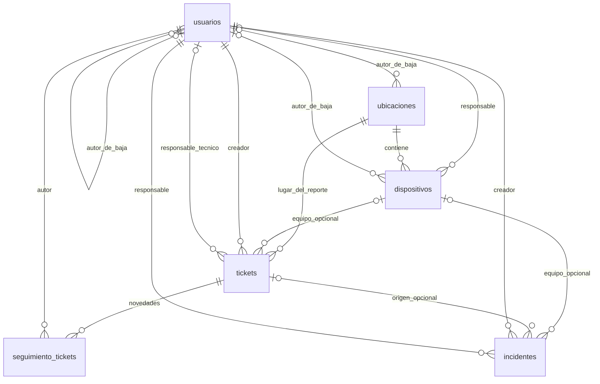

# Base de datos — Versión 1.0, versión final 1

La fuente del esquema es `SchoolDefend/database/schooldefend.sql`. Documentamos seis tablas; no hay tablas de roles, auditoría, talleres, adjuntos ni catálogos editables.

## Relaciones

Un ticket puede tener varios incidentes: `incidentes.id_ticket` no es UNIQUE. Un incidente puede tener a lo sumo un ticket y un dispositivo, ambos opcionales e independientes. No se copia automáticamente el equipo del ticket al incidente.

## Convenciones y responsabilidades

Usamos identificadores `INT UNSIGNED AUTO_INCREMENT`, InnoDB, `utf8mb4` y `utf8mb4_unicode_ci`. Todas las claves foráneas restringen el borrado. Los índices declarados expresamente son claves primarias y UNIQUE; InnoDB también necesita índices para las claves foráneas. No declaramos índices compuestos adicionales.

Las claves foráneas comprueban que una relación exista; no que el usuario tenga cierto rol o que el equipo esté activo. PHP comprueba esas reglas, el CSRF, las transiciones y los requisitos de cierre. No hay CHECK que obligue a incluir solución al resolver ni que limite `activo` a 0 y 1: es un TINYINT cuyo uso 0/1 controla la aplicación. Una escritura directa a la base puede eludir reglas del negocio.

`NULL` expresa ausencia, no un ID cero. `LEFT JOIN` conserva filas que no tienen relación opcional; `INNER JOIN` reúne relaciones obligatorias. Las fechas DATETIME no almacenan una zona horaria: PHP y la conexión SQL se configuran para trabajar de forma coherente en UTC-03:00.

## Diccionario completo

Las definiciones siguientes reproducen tipos, nulabilidad, valores por defecto y restricciones del SQL. PK significa clave primaria; las FK se detallan debajo de cada tabla. El máximo de almacenamiento de SQL no equivale siempre al límite del formulario PHP.

### usuarios

Cuentas de acceso. `nombre_usuario` es único incluso si la cuenta fue desactivada. `password_hash` guarda un verificador generado con PHP, nunca texto de contraseña. Cada cuenta tiene un rol fijo.

| Campo | Definición SQL |
|---|---|
| `id_usuario` | `INT UNSIGNED AUTO_INCREMENT PRIMARY KEY` |
| `nombre` | `VARCHAR(100) NOT NULL` |
| `nombre_usuario` | `VARCHAR(50) NOT NULL UNIQUE` |
| `password_hash` | `VARCHAR(255) NOT NULL` |
| `rol` | `ENUM('administrador','tecnico','profesor') NOT NULL` |
| `fecha_creacion` | `DATETIME NOT NULL DEFAULT CURRENT_TIMESTAMP` |
| `activo` | `TINYINT NOT NULL DEFAULT 1` |
| `fecha_baja` | `DATETIME NULL` |
| `id_usuario_baja` | `INT UNSIGNED NULL` |
| `motivo_baja` | `VARCHAR(255) NULL` |

Relaciones: `FOREIGN KEY (id_usuario_baja) REFERENCES usuarios(id_usuario) ON DELETE RESTRICT`.

### ubicaciones

Sectores físicos. El nombre es único incluso después de una baja; la descripción es opcional.

| Campo | Definición SQL |
|---|---|
| `id_ubicacion` | `INT UNSIGNED AUTO_INCREMENT PRIMARY KEY` |
| `nombre` | `VARCHAR(100) NOT NULL UNIQUE` |
| `descripcion` | `VARCHAR(255) NULL` |
| `activo` | `TINYINT NOT NULL DEFAULT 1` |
| `fecha_baja` | `DATETIME NULL` |
| `id_usuario_baja` | `INT UNSIGNED NULL` |
| `motivo_baja` | `VARCHAR(255) NULL` |

Relaciones: `FOREIGN KEY (id_usuario_baja) REFERENCES usuarios(id_usuario) ON DELETE RESTRICT`.

### dispositivos

Inventario actual. Código institucional único. IP, MAC y número de serie no son únicos. El responsable puede tener cualquier rol; al asignarlo se exige que esté activo. Estado técnico y pertenencia activa al inventario son conceptos diferentes.

| Campo | Definición SQL |
|---|---|
| `id_dispositivo` | `INT UNSIGNED AUTO_INCREMENT PRIMARY KEY` |
| `codigo` | `VARCHAR(30) NOT NULL UNIQUE` |
| `tipo` | `ENUM('pc','notebook','impresora','proyector','router','access_point','otro') NOT NULL` |
| `marca` | `VARCHAR(60) NULL` |
| `modelo` | `VARCHAR(100) NULL` |
| `numero_serie` | `VARCHAR(100) NULL` |
| `sistema_operativo` | `VARCHAR(100) NULL` |
| `ip` | `VARCHAR(45) NULL` |
| `mac` | `VARCHAR(17) NULL` |
| `id_ubicacion` | `INT UNSIGNED NOT NULL` |
| `id_responsable` | `INT UNSIGNED NULL` |
| `estado` | `ENUM('operativo','en_reparacion','fuera_de_servicio') NOT NULL DEFAULT 'operativo'` |
| `observaciones` | `TEXT NULL` |
| `fecha_alta` | `DATETIME NOT NULL DEFAULT CURRENT_TIMESTAMP` |
| `activo` | `TINYINT NOT NULL DEFAULT 1` |
| `fecha_baja` | `DATETIME NULL` |
| `id_usuario_baja` | `INT UNSIGNED NULL` |
| `motivo_baja` | `VARCHAR(255) NULL` |

Relaciones: `FOREIGN KEY (id_ubicacion) REFERENCES ubicaciones(id_ubicacion) ON DELETE RESTRICT`; `FOREIGN KEY (id_responsable) REFERENCES usuarios(id_usuario) ON DELETE RESTRICT`; `FOREIGN KEY (id_usuario_baja) REFERENCES usuarios(id_usuario) ON DELETE RESTRICT`.

### tickets

Reporte original y situación de atención actual. Ubicación obligatoria, equipo opcional. Creador tomado de sesión; prioridad inicial media. El técnico es opcional hasta que el estado exige asignación. La ubicación del ticket no cambia al mover el equipo.

| Campo | Definición SQL |
|---|---|
| `id_ticket` | `INT UNSIGNED AUTO_INCREMENT PRIMARY KEY` |
| `titulo` | `VARCHAR(150) NOT NULL` |
| `descripcion` | `TEXT NOT NULL` |
| `id_ubicacion` | `INT UNSIGNED NOT NULL` |
| `id_dispositivo` | `INT UNSIGNED NULL` |
| `id_creador` | `INT UNSIGNED NOT NULL` |
| `id_tecnico` | `INT UNSIGNED NULL` |
| `prioridad` | `ENUM('baja','media','alta') NOT NULL DEFAULT 'media'` |
| `estado` | `ENUM('abierto','en_proceso','en_espera_repuesto','resuelto','cancelado') NOT NULL DEFAULT 'abierto'` |
| `diagnostico` | `TEXT NULL` |
| `solucion` | `TEXT NULL` |
| `motivo_cancelacion` | `TEXT NULL` |
| `fecha_creacion` | `DATETIME NOT NULL DEFAULT CURRENT_TIMESTAMP` |
| `fecha_cierre` | `DATETIME NULL` |

Relaciones: `FOREIGN KEY (id_ubicacion) REFERENCES ubicaciones(id_ubicacion) ON DELETE RESTRICT`; `FOREIGN KEY (id_dispositivo) REFERENCES dispositivos(id_dispositivo) ON DELETE RESTRICT`; `FOREIGN KEY (id_creador) REFERENCES usuarios(id_usuario) ON DELETE RESTRICT`; `FOREIGN KEY (id_tecnico) REFERENCES usuarios(id_usuario) ON DELETE RESTRICT`.

### seguimiento_tickets

Una fila por operación registrada, con autor, fecha y texto compuesto de cambios/novedad. No hay interfaz de edición o borrado. El historial puede consultarlo el profesor que creó el ticket.

| Campo | Definición SQL |
|---|---|
| `id_seguimiento` | `INT UNSIGNED AUTO_INCREMENT PRIMARY KEY` |
| `id_ticket` | `INT UNSIGNED NOT NULL` |
| `id_usuario` | `INT UNSIGNED NOT NULL` |
| `descripcion` | `TEXT NOT NULL` |
| `fecha` | `DATETIME NOT NULL DEFAULT CURRENT_TIMESTAMP` |

Relaciones: `FOREIGN KEY (id_ticket) REFERENCES tickets(id_ticket) ON DELETE RESTRICT`; `FOREIGN KEY (id_usuario) REFERENCES usuarios(id_usuario) ON DELETE RESTRICT`.

### incidentes

Registro manual reservado a técnico y administrador. Creador y responsable son obligatorios; equipo y ticket son opcionales. Acciones y conclusión se reemplazan al editar; no existe tabla de versiones.

| Campo | Definición SQL |
|---|---|
| `id_incidente` | `INT UNSIGNED AUTO_INCREMENT PRIMARY KEY` |
| `titulo` | `VARCHAR(150) NOT NULL` |
| `tipo` | `ENUM('malware','phishing','acceso_no_autorizado','perdida_equipo','otro') NOT NULL` |
| `descripcion` | `TEXT NOT NULL` |
| `severidad` | `ENUM('baja','media','alta') NOT NULL` |
| `estado` | `ENUM('reportado','en_investigacion','cerrado') NOT NULL DEFAULT 'reportado'` |
| `id_dispositivo` | `INT UNSIGNED NULL` |
| `id_ticket` | `INT UNSIGNED NULL` |
| `id_creador` | `INT UNSIGNED NOT NULL` |
| `id_responsable` | `INT UNSIGNED NOT NULL` |
| `acciones_realizadas` | `TEXT NULL` |
| `conclusion` | `TEXT NULL` |
| `fecha_creacion` | `DATETIME NOT NULL DEFAULT CURRENT_TIMESTAMP` |
| `fecha_cierre` | `DATETIME NULL` |

Relaciones: `FOREIGN KEY (id_dispositivo) REFERENCES dispositivos(id_dispositivo) ON DELETE RESTRICT`; `FOREIGN KEY (id_ticket) REFERENCES tickets(id_ticket) ON DELETE RESTRICT`; `FOREIGN KEY (id_creador) REFERENCES usuarios(id_usuario) ON DELETE RESTRICT`; `FOREIGN KEY (id_responsable) REFERENCES usuarios(id_usuario) ON DELETE RESTRICT`.

## Conservación y normalización

Relacionamos filas mediante IDs para no repetir la ficha del usuario, equipo o ubicación dentro de cada reporte. El seguimiento conserva textos de acciones, no una copia completa de todas las entidades. Los nombres mostrados mediante JOIN son los actuales, por lo que no debemos afirmar que el sistema conserva toda la historia de cambios de nombre o ubicación.

Usuarios, ubicaciones y dispositivos tienen `activo`, `fecha_baja`, `id_usuario_baja` y `motivo_baja`. Reactivar conserva la última baja; otra baja la reemplaza. Tickets e incidentes no tienen `activo`: sus estados finales cumplen otra función. `ON DELETE RESTRICT` protege referencias incluso fuera de la interfaz, pero no impide modificar campos ni borrar filas sin referencias.

No declaramos una demostración formal de tercera forma normal: podemos defender las entidades separadas y sus dependencias por identificador, pero debemos analizar cada dependencia funcional antes de afirmar un nivel de normalización.

## Datos de ejemplo e importación

| Tabla | Filas iniciales |
|---|---:|
| usuarios | 3 |
| ubicaciones | 3 |
| dispositivos | 5 |
| tickets | 5 |
| seguimiento_tickets | 9 |
| incidentes | 2 |

Las filas son ficticias, con fechas de septiembre de 2026. El dispositivo 5 queda inactivo y conserva el ticket 5. El SQL de muestra no agrega entrada inicial a cada ticket histórico, aunque el formulario de alta sí la genera para los nuevos tickets. No confundir el ejemplo de carga con una bitácora exacta de operaciones realizadas desde la interfaz.

Los hashes son placeholders: preparar una copia privada siguiendo [Instalación](INSTALACION.md). El script crea la base y las tablas antes de `START TRANSACTION`; solo la carga de datos está agrupada allí. El DDL no queda protegido por esa transacción, de modo que un error puede dejar un esquema parcialmente creado. No hay migraciones ni versión de esquema almacenada en una tabla.

## Reglas de integridad y validación

- Resolver requiere responsable válido, diagnóstico y solución; cancelar requiere motivo. La fecha final la fija PHP.
- Un incidente cerrado requiere acciones y conclusión; el estado se vuelve a consultar bajo bloqueo.
- Un dispositivo inactivo conserva historial. Las nuevas asignaciones exigen entidades activas, salvo conservación de relaciones previas en equipos inactivos.
- `utf8mb4` permite texto Unicode, mientras `mb_strlen` cuenta caracteres y `strlen` cuenta bytes: no son límites intercambiables.
- Las claves únicas usan la comparación de la colación: no debemos asumir que cambiar solo mayúsculas produce un nombre de usuario distinto.
- La tabla de seguimiento puede crecer indefinidamente; no hay política automática de retención ni archivado.

Las validaciones completas, bajas y transiciones se explican en [Arquitectura](ARQUITECTURA.md).
